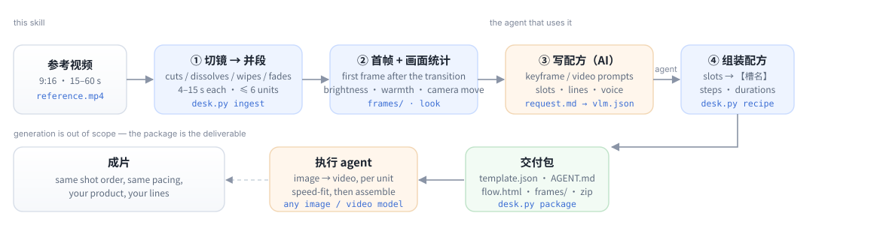

<div align="center">

[English](README.md) · [简体中文](README.zh-CN.md) · [日本語](README.ja.md) · **Español**

</div>

<div align="center">

# video-replica-template

**Convierte un vídeo de referencia en una plantilla de réplica plano a plano que otro agente puede ejecutar tal cual.**

[](LICENSE)
[](https://www.python.org/)
[](https://ffmpeg.org/)
[](#requisitos)
[](#detección-de-planos)

</div>

Si le pasas el vídeo entero a un modelo de vídeo y le dices «hazlo con mi producto», lo que vuelve es **otro
anuncio**: el ritmo se desvía, el producto muta entre planos y la voz en off deja de encajar con la imagen. El
vídeo de referencia es un **plan de montaje**, pero se entrega como una instrucción borrosa de una línea.

Esta skill hace el trabajo del montador que falta. Mira el vídeo como lo haría un editor —cortes, disolvencias,
barridos, cambios de tarjeta gráfica—, agrupa los planos en unidades de generación de 4–15 s, mide cómo se ve
cada unidad (brillo, temperatura de color, movimiento de cámara), saca el primer fotograma limpio de cada una
después de que termine la transición y escribe la receta: prompts de *keyframe* y de *vídeo* por unidad, los
textos que se dicen y ranuras para todo lo que cambia cuando cambia el producto. El resultado es un paquete
autocontenido (`template.json` + `AGENT.md` + `flow.html` + fotogramas + zip) que cualquier agente con un modelo
de imagen y otro de vídeo puede ejecutar, unidad por unidad y en paralelo.

Nunca llama a un modelo de imagen o de vídeo. Sin clave de API, sin red, sin PyTorch.



## Qué produce una ejecución

```text
replica-work/
├── analysis.json              planos, unidades, aspecto medido, instantes de fotograma, avisos
├── frames/u1-first.jpg …      una referencia de composición por unidad
├── request.md                 el briefing que lee el agente (tabla de unidades + 8 reglas)
├── vlm.json                   la respuesta del agente: títulos, prompts, textos, ranuras
├── recipe.json                la plantilla
└── export/<template-id>/      el paquete de entrega
    ├── template.json          receta + bloque handoff legible por máquina
    ├── AGENT.md               instrucciones paso a paso para el agente ejecutor
    ├── flow.html              diagrama de flujo sin conexión, arrastrable
    ├── frames/                primeros fotogramas, rutas relativas, carpetas ASCII
    └── ../<template-id>.zip   la carpeta completa, lista para entregar
```

Un extracto real del paquete de demostración (`examples/demo/template/AGENT.md`); fíjate en la columna del
movimiento medido:

| Unidad | Tiempo en el original | Duración | Vídeo a generar | Aspecto (medido) | Primer fotograma |
|---|---|---|---|---|---|
| 1 | 0.0–5.5s | 5.5s | 6s | Cámara fija · luminoso · cálido · baja saturación | `frames/u1-first.jpg` |
| 2 | 5.5–10.5s | 5.0s | 5s | Cámara fija · luminoso · cálido · baja saturación | `frames/u2-first.jpg` |
| 3 | 10.5–16.0s | 5.5s | 6s | Cámara fija · luminoso · cálido · baja saturación | `frames/u3-first.jpg` |
| 4 | 16.0–20.5s | 4.5s | 5s | Cámara fija · muy oscuro · frío | `frames/u4-first.jpg` |

También avisa cuando las unidades generadas no van a casar entre sí:

```text
跨段一致性（工具量出来的，拼回去之前处理）：
- 段3→段4 色温跳变 -15（暖转冷），生成后建议统一调色
- 段3→段4 亮度跳变 -65（变暗），注意曝光一致
```

(Los avisos del paquete están en chino; consulta [lo que no hace](#lo-que-no-hace).)

## Demostración incluida

`examples/demo/clip.mp4` es un anuncio simulado de 20 s dibujado con Pillow por `examples/make_demo.py` (material
sintético, sin imágenes de terceros) y `examples/demo/template/` es el paquete que la herramienta generó a partir
de él: 4 planos, 4 unidades, prompts, ranuras, `flow.html`, todo. Abre
`examples/demo/template/flow.html` en el navegador para ver el entregable.

```bash
git clone https://github.com/ecoyoung/video-replica-template && cd video-replica-template
python3 scripts/desk.py doctor
python3 scripts/desk.py ingest examples/demo/clip.mp4 /tmp/demo-work --name "Demo"
# abre /tmp/demo-work/request.md y escribe /tmp/demo-work/vlm.json (esto lo hace un agente)
python3 scripts/desk.py recipe  /tmp/demo-work --vlm vlm.json
python3 scripts/desk.py package /tmp/demo-work --out /tmp/demo-out
```

## Instalación

Es una carpeta normal: `SKILL.md` + `references/` + `scripts/`. Funciona con cualquier agente que pueda
ejecutar comandos de shell y leer archivos.

```bash
./install.sh                    # detecta ~/.claude/skills, ~/.dsh/skills, ~/.codex/skills
./install.sh ~/.claude/skills   # o indica la ruta
```

| Agente | Dónde va | Cómo se invoca |
|---|---|---|
| **Claude Code** | `~/.claude/skills/video-replica-template/` | «convierte este vídeo en una plantilla de réplica» |
| **DSH** | `~/.dsh/skills/video-replica-template/` | igual; aparece solo en el catálogo de skills |
| **Codex CLI** | `~/.codex/skills/` | como skill, o pega `SKILL.md` como instrucciones del proyecto |
| **Cursor y otros** | cualquier sitio | dile al agente que lea `SKILL.md`; el CLI es `python3 scripts/desk.py …` |

**Requisitos**: `python3` 3.9+ y `ffmpeg`/`ffprobe` en el `PATH`. `numpy` +
`opencv-python-headless` son opcionales y solo mejoran la detección de planos. En Windows usa `py -3` en lugar
de `python3`; el resto es igual.

## La CLI

Cada comando imprime un único objeto JSON en stdout (`{"ok": true, …}` o `{"ok": false, "error": "…"}`), pensado
para que lo lea un agente.

| Comando | Qué hace |
|---|---|
| `desk.py doctor` | comprueba el entorno: python, ffmpeg, detector activo |
| `desk.py ingest VIDEO WD [--name N] [--max-units 6]` | detección → unidades → primeros fotogramas → `request.md` |
| `desk.py speech WD --transcript f.json` | añade una voz en off con marcas de tiempo (srt / vtt / json / tsv) |
| `desk.py recipe WD --vlm vlm.json` | valida la respuesta del agente y construye la plantilla |
| `desk.py package WD --out DIR [--units 1,2] [--slots …]` | genera el paquete de entrega + zip |
| `desk.py status WD` | en qué punto del proceso está el directorio de trabajo |

`desk.py ingest` devuelve `mode=whole` cuando el vídeo supera 6×15 s o la detección no está disponible; en modo
completo no hay paquete, por diseño.

## Detección de planos

Dos implementaciones, misma salida, se elige sola:

| Detector | Necesita | Encuentra |
|---|---|---|
| `lite` | solo la biblioteca estándar | cortes directos, cortes de salto, cortes por flash, fundidos a negro/blanco |
| `cv2` | `numpy` + `opencv-python-headless` | todo lo anterior **más** disolvencias, barridos, cambios de gráfico, veto por flujo óptico en panorámicas y cámara en mano, etiqueta `flash` |

Cómo decide la ruta `cv2`:

- **Puntuación** por fotograma: distancia de histograma HSV (0.65) y cambio de píxeles (0.35), comparada con una
  mediana móvil, para que un montaje rápido no se suba el listón a sí mismo.
- **Corte**: puntuación > 0.28, > 2.2× la mediana y > 22 % de píxeles tocados; los cortes de salto y los cambios
  de disposición se separan por si el fotograma vuelve a la imagen anterior.
- **Disolvencia**: los fotogramas intermedios son una mezcla lineal (α ∈ 0.25–0.75, residuo < 0.22) y cambian más
  rápido que su entorno; un morph lento se rechaza.
- **Barrido**: ventanas de 0.3/0.6/1.0/1.6 s sobre una rejilla de 3×4 bloques; cada bloque es imagen vieja o
  nueva, la proporción nueva crece de forma monótona y el flujo óptico no lo explica.
- **Fundido**: extremo de luminancia con mesetas a ambos lados y ≥ 3 fotogramas de rampa monótona; un destello de
  un fotograma no es un fundido, se etiqueta `flash`.
- **Gráficos en movimiento**: tramos congelados consecutivos (≥ 0.4 s) cuyos fotogramas intermedios difieren en
  más del 12 % de los píxeles.
- **Un límite por transición**: los eventos llevan intervalo y fotograma de corte, y fundidos/barridos/disolvencias
  mandan sobre los cortes hallados dentro de su intervalo.

En un clip de 43 s a 720×1280: **1.4 s** para detectar 19 planos, **3.1 s** para el ingest completo (incluida la
medición de aspecto).

## Por qué estas reglas

| Regla | Motivo |
|---|---|
| 4–15 s por unidad, máximo 6 | un modelo de vídeo genera 4–15 s de una vez; más unidades, más costuras |
| primer fotograma **después** de la transición inicial | el fotograma medio de una disolvencia es una mezcla; usarlo como referencia funde dos planos |
| movimiento de cámara medido, no adivinado | una imagen fija no dice si hay push-in o trípode |
| el producto siempre se escribe como «el producto subido» | el color y el envase del original arrastran la salida hacia la marca de referencia |
| ranuras solo para lo que cambia con el producto | máximo 5; el producto nunca es una ranura |
| generar más largo y ajustar la velocidad a la duración original | recortar los primeros 1.2 s de un clip de 4 s queda peor que acelerarlo |
| rutas relativas y carpetas ASCII | tiene que abrirse en la máquina de otra persona |

## Lo que no hace

- **No genera**: ni imagen, ni vídeo, ni TTS; eso es trabajo del agente que recibe el paquete.
- **No hace OCR ni extrae subtítulos**: el texto en pantalla se trata como parte de la imagen y no entra en los prompts.
- **Máximo 6 unidades**: referencias más largas hay que cortarlas o repartirlas en varias plantillas.
- **Las etiquetas de cámara son heurísticas** (mediana de tres pares de fotogramas a 0.2 s; si duda, «fija»). Son
  una pista para el prompt, no una medida citable.
- **Cobertura de transiciones limitada**: los barridos radiales, de reloj o pixelados se detectan a medias; los
  morphs estilizados no.
- **Sin análisis de audio**: trae tu propia transcripción con `speech --transcript`.
- **El texto del paquete está en chino** (`AGENT.md`, `request.md`, avisos). Los prompts y los diálogos se
  escriben en el idioma del vídeo original, pero las instrucciones todavía solo están en chino.

## Desarrollo

```bash
python3 scripts/selftest.py                 # 12 pruebas: planos, unidades, voz, aspecto, receta, paquete, e2e
python3 examples/make_demo.py               # regenera el clip de demostración (Pillow + ffmpeg)
python3 -m venv .venv && .venv/bin/pip install numpy opencv-python-headless
.venv/bin/python scripts/selftest.py        # también la ruta cv2
```

CI ejecuta la suite en Python 3.9 y 3.12, con y sin OpenCV.

## Licencia

Apache-2.0. El clip de demostración es sintético y lo genera un script de este repositorio; no incluye
material ni código de terceros. Consulta `NOTICE` para la atribución.

<div align="center">

[Notas de diseño](references/workflow.md) · [Referencia de campos](references/recipe.md)

</div>
