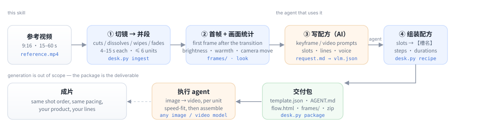

<div align="center">

[English](README.md) · [简体中文](README.zh-CN.md) · **日本語** · [Español](README.es.md)

</div>

<div align="center">

# video-replica-template

**参考動画を、別のエージェントがそのまま実行できる「複製テンプレート」に変換します。**

[](LICENSE)
[](https://www.python.org/)
[](https://ffmpeg.org/)
[](#動作環境)
[](#ショット検出)

</div>

参考動画を丸ごと動画生成モデルに渡して「この商品に差し替えて」と頼むと、返ってくるのは**別の動画**です。
テンポは変わり、商品はショットごとに形を変え、ナレーションは画面と噛み合いません。参考動画は本来
**絵コンテ（ショット割り）** なのに、曖昧な一行の指示として渡されてしまうのが原因です。

このスキルは、その間にある編集者の仕事を代わりにやります。編集者と同じように映像を見て、カット・
ディゾルブ・ワイプ・モーショングラフィックスの切り替わりを検出し、ショットを 4〜15 秒の生成単位に
まとめ、各単位の見え方（明るさ・色温度・カメラワーク）を実測し、トランジションが終わった位置から
きれいなファーストフレームを切り出し、レシピを書きます。単位ごとのキーフレーム／動画プロンプト、
セリフ、商品を差し替えるときに連動して変わる要素のスロットまで含めて。成果物は自己完結したパッケージ
（`template.json` + `AGENT.md` + `flow.html` + フレーム + zip）で、画像生成と動画生成を持つエージェントなら
どれでも、単位ごとに並列で実行できます。

自分では画像も動画も生成しません。API キー不要、ネットワーク不要、PyTorch 不要。



## 出力されるもの

```text
replica-work/
├── analysis.json              ショット・単位・各単位の見え方・フレーム時刻・警告
├── frames/u1-first.jpg …      単位ごとの構図リファレンス
├── request.md                 エージェントが読む指示書（単位表 + 8 箇条）
├── vlm.json                   エージェントの回答：タイトル・プロンプト・セリフ・スロット
├── recipe.json                テンプレート本体
└── export/<template-id>/      ハンドオフパッケージ
    ├── template.json          レシピ + 機械可読な handoff ブロック
    ├── AGENT.md               実行エージェント向けの単位ごと手順
    ├── flow.html              オフラインで動くドラッグ可能なフロー図
    ├── frames/                ファーストフレーム（相対パス・ASCII ディレクトリ名）
    └── ../<template-id>.zip   フォルダ一式、そのまま渡せる
```

デモパッケージ（`examples/demo/template/AGENT.md`）からの実例です。「画面（実測）」の列に注目してください。

| 単位 | 元動画の時間 | 長さ | 生成する長さ | 画面（実測） | ファーストフレーム |
|---|---|---|---|---|---|
| 1 | 0.0–5.5s | 5.5s | 6s | 固定カメラ · 明るい · 暖色 · 低彩度 | `frames/u1-first.jpg` |
| 2 | 5.5–10.5s | 5.0s | 5s | 固定カメラ · 明るい · 暖色 · 低彩度 | `frames/u2-first.jpg` |
| 3 | 10.5–16.0s | 5.5s | 6s | 固定カメラ · 明るい · 暖色 · 低彩度 | `frames/u3-first.jpg` |
| 4 | 16.0–20.5s | 4.5s | 5s | 固定カメラ · 非常に暗い · 寒色 | `frames/u4-first.jpg` |

つなぎ合わせる前に、色が喧嘩する単位を教えてくれます。

```text
跨段一致性（工具量出来的，拼回去之前处理）：
- 段3→段4 色温跳变 -15（暖转冷），生成后建议统一调色
- 段3→段4 亮度跳变 -65（变暗），注意曝光一致
```

（この警告文は中国語です。パッケージ本文の言語については[できないこと](#できないこと)を参照。）

## リポジトリ内のデモ

`examples/demo/clip.mp4` は `examples/make_demo.py` が Pillow で描いた 20 秒の模擬 CM です（合成素材で、
他者の映像は含みません）。`examples/demo/template/` はそれに対してツールが出力したパッケージそのものです。
`examples/demo/template/flow.html` をブラウザで開けば、納品物の見た目が分かります。

```bash
git clone https://github.com/ecoyoung/video-replica-template && cd video-replica-template
python3 scripts/desk.py doctor
python3 scripts/desk.py ingest examples/demo/clip.mp4 /tmp/demo-work --name "デモ"
# /tmp/demo-work/request.md を読み、/tmp/demo-work/vlm.json を書く（ここはエージェントの仕事）
python3 scripts/desk.py recipe  /tmp/demo-work --vlm vlm.json
python3 scripts/desk.py package /tmp/demo-work --out /tmp/demo-out
```

## インストール

ただのフォルダです。`SKILL.md` + `references/` + `scripts/`。シェルが動いてファイルを読み書きできる
エージェントなら何でも使えます。

```bash
./install.sh                    # ~/.claude/skills, ~/.dsh/skills, ~/.codex/skills を自動検出
./install.sh ~/.claude/skills   # 場所を指定してもよい
```

| エージェント | 置き場所 | 呼び出し方 |
|---|---|---|
| **Claude Code** | `~/.claude/skills/video-replica-template/` | 「この動画を複製テンプレートにして」 |
| **DSH** | `~/.dsh/skills/video-replica-template/` | 同上。スキル一覧に自動で載る |
| **Codex CLI** | `~/.codex/skills/` | スキルとして、または `SKILL.md` をプロジェクト指示に貼る |
| **Cursor など** | 任意 | エージェントに `SKILL.md` を読ませる。CLI は `python3 scripts/desk.py …` |

**動作環境**：`python3` 3.9 以上と `ffmpeg`/`ffprobe`（`PATH` 上）。`numpy` +
`opencv-python-headless` は任意で、入れるとショット検出が強くなります。Windows では `python3` を
`py -3` に読み替えてください。

## コマンド

どのコマンドも stdout に JSON を 1 つだけ出します（`{"ok": true, …}` または
`{"ok": false, "error": "…"}`）。エージェントが読む前提の設計です。

| コマンド | 役割 |
|---|---|
| `desk.py doctor` | 環境チェック：python、ffmpeg、使用中の検出器 |
| `desk.py ingest VIDEO WD [--name N] [--max-units 6]` | ショット検出 → 単位化 → ファーストフレーム → `request.md` |
| `desk.py speech WD --transcript f.json` | タイムコード付きナレーションを紐付け（srt / vtt / json / tsv） |
| `desk.py recipe WD --vlm vlm.json [--products 1-3]` | 回答を検証してテンプレートを組み立てる。1 ショットに製品が 2 つ写るなら、製品ごとに 1 枚ずつ参照画像を渡す |
| `desk.py package WD --out DIR [--units 1,2] [--slots …]` | ハンドオフパッケージ + zip |
| `desk.py status WD` | 作業ディレクトリがどこまで進んだか |

6×15 秒を超える長さ、または検出器が使えない場合は `ingest` が `mode=whole` を返します。全体モードでは
パッケージを書き出せません（意図的な仕様です）。

## ショット検出

2 つの実装があり、出力は同じで自動的に切り替わります。

| 検出器 | 必要なもの | 検出できるもの |
|---|---|---|
| `lite` | 標準ライブラリのみ | ハードカット、ジャンプカット、フラッシュカット、黒/白へのフェード |
| `cv2` | `numpy` + `opencv-python-headless` | 上記すべて **＋** ディゾルブ、ワイプ、モーショングラフィックスの切り替え、手ブレ/パンの誤検出抑止、`flash` のラベル付け |

`cv2` 側の判定根拠：

- **スコア**：HSV ヒストグラム距離（0.65）と画素変化（0.35）。移動中央値のベースラインと比較するので、
  速いカット割りが自分の閾値を上げてしまうことがありません。
- **カット**：スコア > 0.28、ベースラインの 2.2 倍超、画素の 22% 超が変化。ジャンプカットとレイアウト
  差し替えは「前の絵に戻るか」で分けます。
- **ディゾルブ**：中間フレームが前後フレームの線形ブレンド（α ∈ 0.25–0.75、残差 < 0.22）で、周囲より速く
  変化していること。ゆっくりしたモーフは棄却。
- **ワイプ**：0.3/0.6/1.0/1.6 秒の窓を 3×4 ブロックで走査。各ブロックは旧画面か新画面のどちらかで、
  新ブロックの割合が単調増加し、オプティカルフローで説明できないこと。
- **フェード**：輝度の極値と両側のプラトー、3 フレーム以上の単調なランプが必要。1 フレームの白飛びは
  フェードではなく `flash`。
- **モーショングラフィックス**：0.4 秒以上の凍結区間が連続し、中間フレームの差が画素の 12% 超。
- **1 つのトランジションに境界は 1 つ**：イベントは区間と境界フレームを持ち、フェード/ワイプ/ディゾルブは
  区間内のカットより優先されます。

43 秒・720×1280 の動画で：検出 **1.4 秒**（19 ショット）、フル ingest **3.1 秒**（見え方の計測込み）。

## なぜこのルールなのか

| ルール | 理由 |
|---|---|
| 1 単位 4〜15 秒、最大 6 単位 | 動画モデルが一度に作れるのが 4〜15 秒。単位が増えるほど継ぎ目が増える |
| ファーストフレームは開始トランジションの**後** | ディゾルブの中間フレームはブレンド画像で、構図リファレンスに使うと 2 ショットが混ざる |
| カメラワークは推測せず実測 | 静止画からはプッシュインか三脚かを判断できない |
| 商品は常に「アップロードした商品」と書く | プロンプトに元商品の色やパッケージを書くと、差し替えても元に引き戻される |
| スロットは商品差し替えで連動する要素だけ | 最大 5 個。商品自体はスロットにしない |
| 長めに生成して元の長さに速度調整 | 4 秒のクリップの頭 1.2 秒を切るより、全体を少し速める方が自然 |
| 相対パス・ASCII ディレクトリ名 | 他人のマシンで開けなければ意味がない |

## できないこと

- **生成はしません**。画像・動画・TTS はすべて受け取る側のエージェントの仕事です。
- **OCR / 字幕抽出はしません**。画面内の文字は絵の一部として扱い、プロンプトには入れません。
- **6 単位の上限**。長い参考動画はカットするか、複数のテンプレートに分けてください。
- **カメラワークの判定はヒューリスティック**（0.2 秒間隔の 3 組のフレームの中央値。迷ったら「固定」）。
  プロンプトのヒントであって、引用できる測定値ではありません。
- **トランジションの対応は有限**。放射状・時計回り・ピクセル化のワイプは部分的にしか拾えず、
  様式化されたモーフは検出できません。
- **音声解析はしません**。ナレーションは自分で文字起こしして `speech --transcript` で渡してください。
- **パッケージ本文は中国語**（`AGENT.md` / `request.md` / 警告文）。プロンプトとセリフは元動画の言語で
  書かれますが、指示文は現在中文のみです。

## 開発

```bash
python3 scripts/selftest.py                 # 31 項目：ショット・単位・ナレーション・言語・見え方・スロット・レシピ・パッケージ・E2E
python3 examples/make_demo.py               # デモ動画を再生成（Pillow + ffmpeg）
python3 -m venv .venv && .venv/bin/pip install numpy opencv-python-headless
.venv/bin/python scripts/selftest.py        # cv2 経路も実行
```

CI は Python 3.9 と 3.12、OpenCV あり/なしの計 3 ジョブで回しています。

## ライセンス

Apache-2.0。デモ動画はこのリポジトリのスクリプトで合成したもので、第三者の映像やコードは含みません。
帰属表示は `NOTICE` を参照してください。

<div align="center">

[設計メモ](references/workflow.md) · [フィールド一覧](references/recipe.md)

</div>
