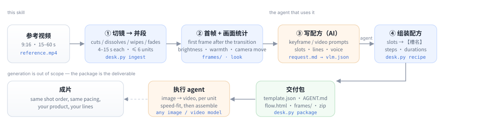

<div align="center">

# video-replica-template

**Turn a reference short video into a shot-by-shot replication template that another agent can actually execute.**

[](LICENSE)
[](https://www.python.org/)
[](https://ffmpeg.org/)
[](#requirements)
[](#shot-detection)

</div>

Ask a video model to "remake this ad with my product" and you get a different ad: the pacing drifts, the
product mutates between shots, the captions stop matching. The clip is a *plan*, but it gets handed over as a
single blurry instruction.

`video-replica-template` is the missing editor step. It watches the reference the way an editor does — cuts,
dissolves, wipes, motion-graphics card changes — groups the shots into 4–15 s generation units, measures what
each unit actually looks like (brightness, colour temperature, camera move), grabs the first clean frame of
every unit, then writes the recipe: per-unit *keyframe* and *video* prompts, the lines to say, and slots for
everything that has to change when the product changes. The deliverable is a self-contained package
(`template.json` + `AGENT.md` + `flow.html` + frames + zip) that any agent with an image model and a video
model can execute — in parallel, one unit at a time.

It never calls an image or video model itself. No API key, no network, no PyTorch.



## What a run produces

```text
replica-work/
├── analysis.json              shots, units, per-unit look, frame times, warnings
├── frames/u1-first.jpg …      one composition reference per unit
├── request.md                 the brief the agent reads (unit table + 8 rules)
├── vlm.json                   the agent's answer: titles, prompts, lines, slots
├── recipe.json                the template in content-desk fields
└── export/<template-id>/      the handoff package
    ├── template.json          recipe + machine-readable handoff block
    ├── AGENT.md               step-by-step instructions for the executing agent
    ├── flow.html              offline, draggable workflow diagram
    ├── frames/                first frames, relative paths, ASCII folder names
    └── ../<template-id>.zip   the whole folder, ready to hand over
```

A real excerpt from the demo package (`examples/demo/template/AGENT.md`) — note the measured camera move:

| 段 | 原片时间 | 原片时长 | 生成视频时长 | 画面（实测） | 首帧参考图 |
|---|---|---|---|---|---|
| 1 | 0.0–5.5s | 5.5s | 6s | 固定机位 · 明亮 · 偏暖 · 低饱和 | `frames/u1-first.jpg` |
| 2 | 5.5–10.5s | 5.0s | 5s | 固定机位 · 明亮 · 偏暖 · 低饱和 | `frames/u2-first.jpg` |
| 3 | 10.5–16.0s | 5.5s | 6s | 固定机位 · 明亮 · 偏暖 · 低饱和 | `frames/u3-first.jpg` |
| 4 | 16.0–20.5s | 4.5s | 5s | 固定机位 · 很暗 · 偏冷 | `frames/u4-first.jpg` |

It also warns when the generated units would not match each other:

```text
跨段一致性（工具量出来的，拼回去之前处理）：
- 段3→段4 色温跳变 -15（暖转冷），生成后建议统一调色
- 段3→段4 亮度跳变 -65（变暗），注意曝光一致
```

## Demo (in this repo)

`examples/demo/clip.mp4` is a synthetic 20 s mock ad (rendered by `examples/make_demo.py`, no copyrighted
footage) and `examples/demo/template/` is the package the tool produced from it — 4 shots, 4 units, prompts,
slots, `flow.html`, the lot. Open `examples/demo/template/flow.html` in a browser to see the deliverable.

```bash
git clone https://github.com/ecoyoung/video-replica-template && cd video-replica-template
python3 scripts/desk.py doctor
python3 scripts/desk.py ingest examples/demo/clip.mp4 /tmp/demo-work --name "Demo"
# open /tmp/demo-work/request.md, write /tmp/demo-work/vlm.json (an agent does this part)
python3 scripts/desk.py recipe  /tmp/demo-work --vlm vlm.json
python3 scripts/desk.py package /tmp/demo-work --out /tmp/demo-out
```

## Install

The skill is a plain folder: `SKILL.md` + `references/` + `scripts/`. It works with any agent that can run
shell commands and read files.

```bash
./install.sh                    # auto-detects ~/.claude/skills, ~/.dsh/skills, ~/.codex/skills
./install.sh ~/.claude/skills   # or say where
```

| Agent | Where it goes | How it gets invoked |
|---|---|---|
| **Claude Code** | `~/.claude/skills/video-replica-template/` | "把这支片子做成复刻模板" / "turn this ad into a replica template" |
| **DSH** | `~/.dsh/skills/video-replica-template/` | same, picked up by the skill catalog |
| **Codex CLI** | `~/.codex/skills/` | as a skill, or paste `SKILL.md` as project instructions |
| **Cursor / others** | anywhere | point the agent at `SKILL.md`; the CLI is just `python3 scripts/desk.py …` |

**Requirements**: `python3` 3.9+ and `ffmpeg`/`ffprobe` on `PATH`. `numpy` + `opencv-python-headless` are
optional and only unlock the better shot detector. Windows: use `py -3` instead of `python3`; everything else
is the same.

## The CLI

Every command is one JSON object on stdout (`{"ok": true, …}` or `{"ok": false, "error": "…"}`), designed for
agents to read rather than humans.

| Command | What it does |
|---|---|
| `desk.py doctor` | environment check: python, ffmpeg, active detector |
| `desk.py ingest VIDEO WD [--name N] [--max-units 6]` | shot detection → units → first frames → `request.md` |
| `desk.py speech WD --transcript f.json` | attach a timecoded voice-over (srt / vtt / json / tsv) |
| `desk.py recipe WD --vlm vlm.json` | validate the agent's answer, build the template |
| `desk.py package WD --out DIR [--units 1,2] [--slots …]` | render the handoff package + zip |
| `desk.py status WD` | where the work directory is in the pipeline |

`desk.py ingest` returns `mode=whole` when the clip is longer than 6×15 s or detection is unavailable; in
whole mode there is no package, by design.

## Shot detection

Two implementations, same output, chosen automatically:

| Detector | Needs | Finds |
|---|---|---|
| `lite` | nothing but the stdlib | hard cuts, jump cuts, flash cuts, fades through black/white |
| `cv2` | `numpy` + `opencv-python-headless` | everything above **plus** dissolves, wipes, motion-graphics card changes, optical-flow veto for pans and handheld, `flash` labelling |

How the `cv2` path decides:

- **Score** per frame from HSV-histogram distance (0.65) and pixel change (0.35), compared against a rolling
  median baseline, so a fast-edit sequence does not raise the bar for itself.
- **Cut** needs score > 0.28, > 2.2× baseline, and > 22 % of pixels touched; jump cuts and layout swaps are
  separated by whether the frame comes back to the previous picture.
- **Dissolve** is a linear blend in the middle frames (α ∈ 0.25–0.75, residual < 0.22) that changes faster than
  its surroundings — a slow morph is rejected.
- **Wipe** scans 0.3/0.6/1.0/1.6 s windows on a 3×4 block grid: each block must be either the old picture or the
  new one, new blocks must grow monotonically, and a motion veto must not explain it.
- **Fade** needs a brightness extreme with plateaus on both sides and ≥ 3 moving frames of ramp — a one-frame
  flash does not count as a fade, it is labelled `flash`.
- **Motion graphics** are consecutive frozen holds (≥ 0.4 s) whose mid-frames differ over > 12 % of pixels.
- **One boundary per transition**: events carry a span and a boundary frame, and fades/wipes/dissolves outrank
  cuts found inside their span, so a cross-fade cannot leave a cut behind it.

On a 43 s 720×1280 clip: **1.4 s** to detect 19 shots, **3.1 s** for the full ingest (including the look pass).

## Why these rules

| Rule | Why it exists |
|---|---|
| 4–15 s per unit, ≤ 6 units | video models generate 4–15 s in one go; more units means more seams |
| first frame taken *after* the opening transition | a dissolve's middle frame is a blend; using it as the composition reference merges two shots |
| camera move measured, not guessed | a still frame tells you nothing about push-in vs tripod |
| product always written as "the uploaded product" | colour and packaging in the prompt drag the output back to the reference brand |
| slots only for things that change with the product | 5 max; product itself is never a slot |
| generate longer, then speed-fit to the original duration | cutting the first 1.2 s of a 4 s clip looks worse than speeding it up |
| package paths relative, folder names ASCII | it has to open on someone else's machine |

## What it does not do

- **No generation.** No image, no video, no TTS — that is the receiving agent's job.
- **No OCR / caption extraction.** On-screen text is treated as part of the picture and excluded from prompts.
- **Six units hard cap.** Longer references need a cut or several templates.
- **Camera-move labels are heuristic** (median of three 0.2 s frame pairs, defaults to "static" when unsure).
  They are a prompt hint, not a measurement you can quote.
- **Transition coverage is finite**: radial/clock/pixelate wipes are partially caught by the window scan;
  stylised morphs are not.
- **No audio analysis.** Bring your own transcript (`speech --transcript`).

## Development

```bash
python3 scripts/selftest.py                 # 11 checks: shots, units, speech, look, recipe, package, e2e
python3 examples/make_demo.py               # regenerate the demo clip (Pillow + ffmpeg)
.venv/bin/pip install numpy opencv-python-headless && .venv/bin/python scripts/selftest.py
```

CI runs the suite on Python 3.9 and 3.12 with and without OpenCV.

## License

MIT. The demo clip is synthetic and generated by the script in this repo; no third-party footage or code is
included.

<div align="center">

[中文说明](README.zh-CN.md) · [Design notes](references/workflow.md) · [Field reference](references/recipe.md)

</div>
