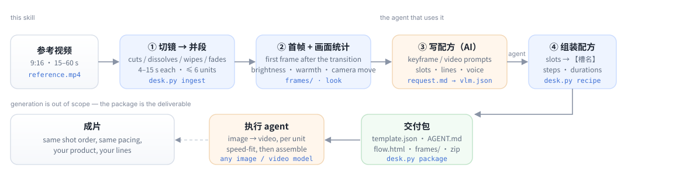

<div align="center">

[English](README.md) · **简体中文** · [日本語](README.ja.md) · [Español](README.es.md)

</div>

<div align="center">

# video-replica-template

**把一条参考短视频，拆成另一个 agent 照着就能执行的复刻模板。**

[](LICENSE)
[](https://www.python.org/)
[](https://ffmpeg.org/)
[](#环境要求)
[](#切镜器)

</div>

把整条参考片丢给视频模型说「换成我的产品」，出来的是一支**别的片子**：节奏漂、产品在镜头之间变形、
口播和画面对不上。参考片其实是一份**分镜计划**，但被当成一句模糊的指令交了出去。

这个 skill 补的是中间那一步——像个剪辑师那样看片：认出硬切、叠化、划像、MG 卡片换页，把镜头并成
4–15 秒的生成段，逐段量出画面（亮度、冷暖、运镜），在转场结束之后取一张干净的首帧，然后写配方：每段的
「首帧图生图 / 图生视频」提示词、台词，以及换产品时要跟着换的槽位。交付物是一个自包含的包
（`template.json` + `AGENT.md` + `flow.html` + 首帧 + zip），任何有生图、生视频能力的 agent 都能逐段执行。

它自己不生成任何图片或视频：没有 API key、不联网、不装 PyTorch。



## 跑完得到什么

```text
replica-work/
├── analysis.json              镜头、分段、每段画面特征、取帧时间、告警
├── frames/u1-first.jpg …      每段的构图参考帧
├── request.md                 给 agent 读的任务书（段表 + 9 条规则）
├── vlm.json                   agent 的答案：标题、提示词、台词、槽位
├── recipe.json                配方本体
└── export/<模板id>/           交付包
    ├── template.json          配方 + 机器可读的 handoff 摘要
    ├── AGENT.md               给执行 agent 的逐段说明
    ├── flow.html              离线、可拖动的流程图
    ├── frames/                首帧，相对路径、ASCII 目录名
    └── ../<模板id>.zip        整包，直接丢给对方
```

真实片段（就是仓库里 `examples/demo/template/AGENT.md` 的内容，注意「画面（实测）」这一列）：

| 段 | 原片时间 | 原片时长 | 生成视频时长 | 画面（实测） | 首帧参考图 |
|---|---|---|---|---|---|
| 1 | 0.0–5.5s | 5.5s | 6s | 固定机位 · 明亮 · 偏暖 · 低饱和 | `frames/u1-first.jpg` |
| 2 | 5.5–10.5s | 5.0s | 5s | 固定机位 · 明亮 · 偏暖 · 低饱和 | `frames/u2-first.jpg` |
| 3 | 10.5–16.0s | 5.5s | 6s | 固定机位 · 明亮 · 偏暖 · 低饱和 | `frames/u3-first.jpg` |
| 4 | 16.0–20.5s | 4.5s | 5s | 固定机位 · 很暗 · 偏冷 | `frames/u4-first.jpg` |

拼回去之前它会先提醒哪几段在颜色上会打架：

```text
跨段一致性（工具量出来的，拼回去之前处理）：
- 段3→段4 色温跳变 -15（暖转冷），生成后建议统一调色
- 段3→段4 亮度跳变 -65（变暗），注意曝光一致
```

## 仓库里的演示

`examples/demo/clip.mp4` 是 `examples/make_demo.py` 用 Pillow 画出来的 20 秒模拟广告（合成素材，不含任何
他人视频），`examples/demo/template/` 就是工具对它产出的交付包：4 个镜头、4 段、提示词、槽位、`flow.html` 全在。
用浏览器打开 `examples/demo/template/flow.html` 就能看到交付物长什么样。

```bash
git clone https://github.com/ecoyoung/video-replica-template && cd video-replica-template
python3 scripts/desk.py doctor
python3 scripts/desk.py ingest examples/demo/clip.mp4 /tmp/demo-work --name "演示"
# 打开 /tmp/demo-work/request.md，写 /tmp/demo-work/vlm.json（这一步是 agent 干的）
python3 scripts/desk.py recipe  /tmp/demo-work --vlm vlm.json
python3 scripts/desk.py package /tmp/demo-work --out /tmp/demo-out
```

## 安装

就是个普通目录：`SKILL.md` + `references/` + `scripts/`。任何能跑 shell、能读写文件的 agent 都能用。

```bash
./install.sh                    # 自动找 ~/.claude/skills、~/.dsh/skills、~/.codex/skills
./install.sh ~/.claude/skills   # 或者指定位置
```

| Agent | 放哪 | 怎么触发 |
|---|---|---|
| **Claude Code** | `~/.claude/skills/video-replica-template/` | 「把这支片子做成复刻模板」 |
| **DSH** | `~/.dsh/skills/video-replica-template/` | 同上，技能目录会自动收录 |
| **Codex CLI** | `~/.codex/skills/` | 当 skill 用，或把 `SKILL.md` 贴进项目规则 |
| **Cursor / 其他** | 任意位置 | 让 agent 读 `SKILL.md`；命令行就是 `python3 scripts/desk.py …` |

**环境要求**：`python3` 3.9+、`ffmpeg`/`ffprobe` 在 `PATH` 里。`numpy` + `opencv-python-headless` 可选，
只影响切镜能力。Windows 把 `python3` 换成 `py -3`，其余一样。

## 命令

每个子命令只往 stdout 打一个 JSON（`{"ok": true, …}` 或 `{"ok": false, "error": "…"}`），方便 agent 读。

| 命令 | 作用 |
|---|---|
| `desk.py doctor` | 环境自检：python、ffmpeg、当前用哪个切镜器 |
| `desk.py ingest VIDEO WD [--name N] [--max-units 6]` | 切镜 → 分段 → 抽首帧 → 写 `request.md` |
| `desk.py speech WD --transcript f.json` | 挂上带时间码的口播（srt / vtt / json / tsv） |
| `desk.py recipe WD --vlm vlm.json [--products 1-3]` | 校验 agent 的答案，组装配方；一镜里有几件产品就给几张参考图 |
| `desk.py package WD --out DIR [--units 1,2] [--slots …]` | 生成交付包 + zip |
| `desk.py status WD` | 当前工作目录走到哪一步 |

片子超过 6×15 秒、或切镜不可用时，`ingest` 返回 `mode=whole`；整片模式导出不了交付包，这是设计如此。

## 切镜器

两套实现，输出一致，自动选择：

| 检测器 | 依赖 | 能认 |
|---|---|---|
| `lite` | 只要标准库 | 硬切、跳切、闪切、黑白淡入淡出 |
| `cv2` | `numpy` + `opencv-python-headless` | 上面全部 **加上** 叠化、划像、MG 卡片换页、光流防误切，闪光单独标 `flash` |

`cv2` 路径的判据：

- **分数**：HSV 直方图距离（0.65）+ 像素变化（0.35），跟滚动中位数基线比，快剪不会把自己门槛抬高。
- **硬切**：分数 > 0.28、> 2.2× 基线、> 22% 像素被改动；跳切和版式替换按「有没有回到上一帧画面」区分。
- **叠化**：中间帧是前后帧的线性混合（α ∈ 0.25–0.75、残差 < 0.22），且变化比周围更快——缓慢 morph 会被拒。
- **划像**：0.3/0.6/1.0/1.6 秒窗口在 3×4 网格上扫描，每块要么旧画面、要么新画面，新块占比单调增长，
  且光流解释不了才算。
- **淡入淡出**：亮度极值 + 两侧平台 + ≥3 帧单调斜坡；一帧白闪不算淡入淡出，标 `flash`。
- **MG 换页**：连续冻结 ≥0.4 秒的停顿之间，中间帧画面差异 > 12%。
- **一个转场只切一刀**：事件带区间和边界帧，淡入淡出/划像/叠化压过落在区间内的硬切，叠化不会顺带留个假切点。

43 秒 720×1280 的片子：切镜 **1.4 秒**（19 个镜头），完整 ingest **3.1 秒**（含画面统计）。

## 为什么是这些规则

| 规则 | 原因 |
|---|---|
| 每段 4–15 秒、最多 6 段 | 视频模型单次能生成 4–15 秒；段越多接缝越多 |
| 首帧取在开场转场**结束之后** | 叠化中间帧是混合帧，拿它当构图参考会把两个镜头混成一个 |
| 运镜是量出来的，不是猜的 | 一张静帧看不出推拉还是三脚架 |
| 产品一律写「上传的产品」 | 提示词里写着原产品的颜色包装，换了产品图也会被拉回去 |
| 槽位只放「换产品要跟着换」的内容 | 最多 5 个；产品本身不做槽位 |
| 生成长一点，再变速剪回原时长 | 截前 1.2 秒比把 4 秒整段加速更难看 |
| 交付包用相对路径 + ASCII 目录名 | 对方机器上解压就能用 |

## 不做什么

- **不生成**：不出图、不出视频、不做 TTS——那是执行 agent 的事。
- **不做 OCR / 字幕提取**：画面上的文字当画面处理，不进提示词。
- **硬上限 6 段**：更长的片子需要截取或拆成多个模板。
- **运镜判断是启发式**（取镜头内 3 对相隔 0.2 秒的帧求中位数，拿不准就写固定机位）。它是提示词参考，不是可以引用的测量值。
- **转场覆盖有限**：径向/时钟/像素化划像只能部分命中，风格化 morph 认不出来。
- **不做音频分析**：口播自己转好再 `speech --transcript` 挂进来。

## 开发

```bash
python3 scripts/selftest.py                 # 29 项（装 numpy+opencv 后 37 项）：切镜、分段、口播、画面统计、槽位、配方、交付包、端到端
python3 examples/make_demo.py               # 重新生成演示片（Pillow + ffmpeg）
python3 -m venv .venv && .venv/bin/pip install numpy opencv-python-headless
.venv/bin/python scripts/selftest.py        # 再跑一遍，覆盖 cv2 路径
```

CI 在 Python 3.9 和 3.12 上各跑一遍，有 OpenCV 和无 OpenCV 各一遍。

## 许可

Apache-2.0。演示片是脚本合成、随仓库生成；不含任何第三方视频或代码。署名信息见 `NOTICE`。

<div align="center">

[设计说明](references/workflow.md) · [字段清单](references/recipe.md)

</div>
