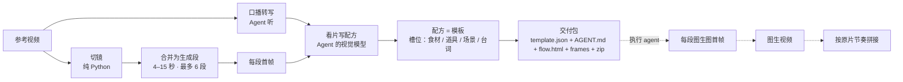

# 流程图

虚线部分由收到交付包的执行 agent 完成，本插件不做。

## 每一步解决什么

| 步骤 | 防止的问题 |
|---|---|
| 工具切镜而不是让模型看 | 模型数不准切点，镜头数和节奏会漂 |
| 同场景连续硬切并成一段（≤10 秒、≤4 镜） | 段太碎时每段都要单独生成，片子割裂；跨场景合并又会让模型糊成一镜 |
| 每段 4–15 秒 | 视频模型单次时长上下限 |
| 先出首帧静帧（图 1 构图 + 图 2 产品） | 产品外观、logo 在静帧上最容易控住，视频里很难再改 |
| 首帧取在开场转场结束之后 | 叠化/淡入的中间帧是混合帧，糊；拿它当构图参考会把两镜混成一镜 |
| 逐帧量运镜、明暗、冷暖写进段表 | 静帧看不出推拉和手持；模型自己猜的运镜会和原片拧着来 |
| 产品只写「上传的产品」 | 提示词里写着原产品颜色包装，换了产品图也会被拉回去 |
| 槽位 `【槽名】` | 换产品时要跟着换的内容（食材、道具…）一处填写，全片生效 |
| 槽位改了先改台词（AGENT.md 里给了改写提示词） | 画面换成草莓，嘴里还在说香蕉 |
| 生成时长 → 变速剪回原时长（写进拼接说明） | 模型最短 4 秒，1.2 秒的镜头整段加速比只截前 1.2 秒自然 |
| 交付包自包含、路径相对、文件夹名 ASCII | 执行 agent 在别的机器、别的系统上也能直接用 |

## 切镜器

两个实现，同一套输出，`desk.py doctor` 的 `detector` 字段告诉你当前用哪个：

| 检测器 | 条件 | 能切 |
|---|---|---|
| `lite`（默认，纯标准库） | 只要 ffmpeg | 硬切、跳切、闪切、淡入淡出 |
| `cv2`（可选，更全） | 装了 numpy + opencv | 上面全部 + 叠化、划像、MG 卡片换页；手摇/横移不误切 |

切点规则是「整幅画面变化 vs 局部变化」：分数 = 直方图距离 + 像素差，与前后 ±0.5 秒的中位数比较，
明显高出才算切点——所以字幕弹出、灯光闪烁、手持晃动不会误切。

`cv2` 额外认这几种：

| 转场 | 判据 |
|---|---|
| 叠化 | 中间帧 ≈ 前后帧的线性混合（投影出 α 算残差），且变化比窗外更快（排除渐变、morph） |
| 划像 | 0.3–1.6 秒窗口里逐块扫描：每块要么还是旧画面、要么已是新画面，新块占比从 0 长到 1、不回翻 |
| 淡入淡出 | 亮度极值帧 + 两侧平台、中间单调斜坡（studio range 的黑是 16 不是 0） |
| MG 换页 | 冻结 ≥0.4 秒的停顿之间比对，画面差得多就是两张不同的卡 |
| 闪光 | 亮度骤升一帧就回落、画面复位 → 标 `flash` 而不是 `cut` |
| 防误切 | Farneback 光流：后一帧能 warp 回前一帧的，是运动不是切点 |

`lite` 把这些都当同一镜头。检测不到就按抽帧手工定段，别指望模型数镜头。
